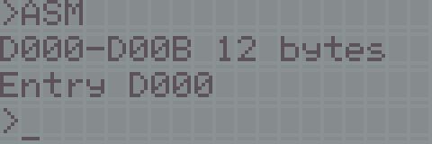

# EASM: a Z80 assembler for the VTech Genio 2000

*By Santiago Crespo, 2026. The instruction encoder inside it is R.T. Russell's, from BBC BASIC (Z80).*

EASM is a 32 KiB cartridge for the Spanish VTech Genio 2000 that turns it into a small Z80
development system. Everything runs on the Genio's own Z80: no BASIC and no PC are needed.

* a **source editor** for the 4x20 LCD, with sideways scrolling, line numbers, and mnemonics on the
  activity keys;
* a **two-pass assembler**: all official Z80 instructions, labels, forward references, expressions,
  `ORG EQU DB DW DS END`, errors with their line number;
* a **monitor**: line-by-line assembler, **disassembler**, memory viewer and editor, fill, compare,
  run, registers after the run;
* a **guide** on the HELP key: one page with an example for every mnemonic and directive, and pages
  on the editor, commands, syntax, registers, flags, the API and the memory map;
* an **API** at fixed addresses (`PRINTSTR`, `GETKEY`, ...) that programs call, with built-in names.

| Editor | ASM | RUN |
|---|---|---|
|  |  |  |

*(MAME snapshots of the demonstration program; the gaps between characters are the LCD's.)*

## A first program
In the editor (ANSWER switches between the editor and the command line):
```
ORG USERRAM
START:
  LD HL,MESSAGE
  CALL PRINTSTR
  RET
MESSAGE:
  DB "HOLA",0
```
Then `RUN` at the command line, or the BASIC key of the activity panel. `USERRAM` is 0xD000 and
`PRINTSTR` is the API entry at 0x8010; both are built-in names. `HOLA` is printed and the program's
`RET` comes back to EASM. The test `tests/t01_demo.txt` types this program key by key in MAME and
checks the bytes (`21 07 D0 CD 10 80 C9 48 4F 4C 41 00`), the output and the return.

## Documents
* [docs/MANUAL.md](docs/MANUAL.md): the user's manual (keys, editor, syntax, commands, monitor, API, errors).
* [docs/DESIGN.md](docs/DESIGN.md): technical design: the audit of EBASIC, the choice of the assembler
  core, the architecture, the assembler and monitor internals, and the interfaces planned for later.
* [docs/MEMORY_MAP.md](docs/MEMORY_MAP.md): ROM pages, RAM layout, I/O ports, the API table.
* [docs/COMPATIBILITY.md](docs/COMPATIBILITY.md): what was tested and how, what was not, the risks on
  the real unit, and the differences from other Z80 assemblers.
* [docs/STATUS.md](docs/STATUS.md): what is implemented and what is pending.

## Building
```bash
make
```
Needs `sdasz80` and `sdldz80` (SDCC 4.5) and `python3`. It writes:

| File | What |
|---|---|
| `easm_gl2000_AT28C256_32K.bin` | the cartridge image for an AT28C256 EEPROM (page 1, then page 2) |
| `easm_gl2000_mame_64K.bin` | the same twice, for MAME's `-cart` |
| `out/easm.sym` | every symbol of both pages (address, page, name) |
| `out/page1.map`, `out/page2.map` | the linker maps |
| `out/usage.txt` | ROM and RAM use (printed by `make`) |
| `out/ramvars.txt` | the RAM addresses, for the tests |

## Testing
```bash
make test
```
Runs every test in headless MAME (`tests/`): scripted key presses with checks of the screen and of
memory, the whole instruction set against MAME's `unidasm`, and a sweep of every opcode through the
disassembler. Needs MAME's `genio` build in `~/PROYECTOS/genio2000/mame-upstream` (or `MAME=...`) and
`unidasm`. See [docs/COMPATIBILITY.md](docs/COMPATIBILITY.md) for the results.

## Status
**Verified only in MAME.** Nothing of EASM has run on a real Genio 2000 yet. It reuses EBASIC's
drivers, which were also verified only in MAME; [docs/COMPATIBILITY.md](docs/COMPATIBILITY.md) lists
the risks on the unit.

## Licence
* GPL-3.0-or-later (`LICENSE`), Copyright (C) 2026 Santiago Crespo: EASM's own files, and the parts
  taken from EBASIC (same author and licence): the LCD and keyboard drivers, the start-up, the
  trampolines, the guide's viewer and compressor, the MAME driver script, and the build tools.
* zlib licence: `third_party/bbcz80/` holds R.T. Russell's `ASMB.Z80` unchanged, with its
  `licence.txt`. `src/asmb.s` is an altered version of it, marked as such in its header. The name
  "BBC BASIC" is not used for this cartridge.
